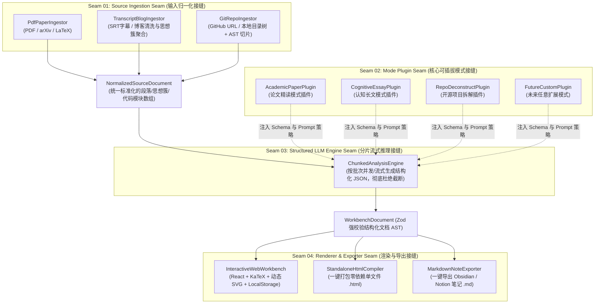

# 深度精读与项目拆解工作台 (Prism Workbench) 架构设计与开发路线图

> 文档版本：V1.0 (Zero-Emoji Engineering Specification)  
> 架构设计原则：Deep Modules（深模块）、Clean Seams（清晰接缝）、Plugin-First（插件化模式扩展）、Schema-Driven Rendering（结构化数据驱动渲染）

---

## 一、 核心架构哲学：如何实现“高内聚、低耦合、高可插拔”

如果把「学术论文精读」「认知长文内化」「GitHub 项目拆解」写成三个散乱的页面或三段硬编码的巨型 Prompt，系统很快会面临三大工程灾难：
1. **Token 截断与 HTML 损坏**：让大模型直接拼接几千行 HTML 标签，不仅浪费 40% 的输出 Token 在 `<div>` 闭合标签上，且长文极易在中途截断导致页面崩溃。
2. **UI 交互无法复用**：80/20 核心过滤、双向跨节跳转、左下角返回原位置、边界感知悬浮窗、逐段随手记、Markdown 导出等能力，在三个模式中本质完全相同，硬编码会导致改一处动三处。
3. **新模式扩展成本极高**：未来若想增加第 4 种模式（如「大厂系统设计文档 RFC 拆解」或「英文原版书章节精读」），不得不重写整条链路。

### 破局方案：将“不变的阅读器骨架”与“可变的领域分析插件”彻底解耦

通过审视前期的 V4 原型，我们可以提炼出整个系统的不变骨架（Invariant Core）与可变插槽（Pluggable Slots）：

- **不变的底层骨架（高内聚内核）**：
  - 顶部导航 + 五色维度聚焦过滤状态机 + 80/20 权重折叠引擎；
  - 顶层认知面板（三栏核心卡片 + 原生可交互 SVG 画布 + 核心词典条）；
  - 主体双栏同行网格（`.para-row`：左栏双语/代码对照 + 右栏 4 模块结构化批注 + 逐段随手记 + 双向跳转锚点）；
  - 底部复盘与交互式工作台（流程图 + 折叠问答/输入框 + 本地持久化 + 双格式导出引擎：导出独立 `.html` 单文件 / 导出 `.md` 笔记）。
- **可变的模式插件（低耦合插件 `ModePlugin`）**：
  - 输入源解析器（PDF/LaTeX vs. 字幕/博客文本 vs. Git 仓库目录树与源码）；
  - 五维高亮的语义定义（色彩复用，语义标签随模式切换）；
  - 右栏 4 个批注模块的 Schema 定义与 Prompt 约束；
  - 底部工作台的交互组件类型（苏格拉底折叠自测 vs. 1-Day 深度书写框 vs. 简历 STAR 话术与 2 小时魔改方案）。

---

## 二、 系统分层与四大核心接缝（Seams & Deep Modules）

系统严格划分为四个深模块（Deep Modules），模块之间仅通过强类型接口（Interfaces）在四个接缝（Seams）处通信：



---

## 三、 核心接口契约设计（TypeScript 核心数据结构）

为了保证极高的可插拔性，任何新增模式只需实现 `WorkbenchModePlugin` 接口并注册到 `PluginRegistry`，无需修改任何一行前端渲染或后端调度代码：

```typescript
// src/core/contracts/mode-plugin.ts
import { z } from "zod";

export typeModeId = "academic-paper" | "cognitive-essay" | "repo-deconstruct" | string;
export type UnitWeight = "core" | "support" | "transition";
export type HighlightDimensionKey = "dim1" | "dim2" | "dim3" | "dim4" | "dim5";

/**
 * 五维高亮配置：颜色视觉层全局统一（黄/红/蓝/绿/紫），语义标签由插件定义
 */
export interface DimensionSpec {
  key: HighlightDimensionKey;
  colorSlot: "yellow" | "red" | "blue" | "green" | "purple";
  label: string;          // 例：论文版为"核心论点"，项目版为"核心架构决策"
  extractionRule: string; // 注入给 LLM 的提取准则
  enableTooltip?: boolean;// 红色维度默认开启自适应边界悬浮释义
}

/**
 * 统一输入单元（无论是论文自然段、博客思想簇、还是项目核心函数，均归一化为此结构）
 */
export interface SourceUnit {
  id: string;             // 如 "sec3-2-1" | "unit-04" | "mod-02"
  sectionId: string;
  sectionTitle: string;
  rawPrimaryText: string; // 英文原文 或 核心源码片段
  metadata?: {
    filePath?: string;    // 仅项目拆解模式使用
    formulas?: string[];  // 提取出的独立公式
  };
}

/**
 * 核心可插拔契约：定义一个模式所需的一切全部收敛在此接口内
 */
export interface WorkbenchModePlugin<TTopModel = unknown, TBottomArsenal = unknown> {
  id: ModeId;
  name: string;
  description: string;
  layoutRatio: [number, number]; // 如论文 [58, 42]，博客/项目 [56, 44]

  // 1. 输入预处理适配器（清洗、分段、聚合或 AST 提取）
  preprocessSource(rawInput: string | File | Record<string, string>): Promise<SourceUnit[]>;

  // 2. 五维高亮语义定义
  dimensions: [DimensionSpec, DimensionSpec, DimensionSpec, DimensionSpec, DimensionSpec];

  // 3. 右栏 4 模块批注的标签定义
  annotationModuleLabels: [string, string, string, string];

  // 4. Zod 强类型校验 Schema（用于 LLM Structured Outputs）
  schemas: {
    topMentalModel: z.ZodType<TTopModel>;
    unitAnnotation: z.ZodType<{
      weight: UnitWeight;
      tldr: string;
      secondaryBlockText: string; // 中文学术意译 / 专栏译文 / 状态流转契约
      tensorOrStateFlow?: string; // 公式张量维度流 或 函数输入输出契约
      highlights: Array<{ text: string; dim: HighlightDimensionKey; tooltip?: string }>;
      notes: [
        { body: string; echoTargetId?: string; echoLabel?: string }, // 模块 01（带双向跳转锚点）
        { body: string },                                            // 模块 02
        { body: string },                                            // 模块 03
        { body: string; actionTrigger?: string }                     // 模块 04
      ];
    }>;
    bottomWorkbench: z.ZodType<TBottomArsenal>;
  };

  // 5. 分阶段 Prompt 构造器（将大任务拆解为不截断的结构化批次）
  buildPrompts: {
    topModelPrompt(units: SourceUnit[]): string;
    batchUnitsPrompt(batch: SourceUnit[], globalContextSummary: string): string;
    bottomWorkbenchPrompt(units: SourceUnit[], topModel: TTopModel): string;
  };
}
```

---

## 四、 技术栈选型（Tech Stack）

推荐采用 **全栈 TypeScript 单体仓库（Monorepo / Next.js App Router）** 架构，原因在于 Zod Schema 可以前后端 100% 共享，直接打通「大模型结构化 JSON 输出 -> 前端类型安全渲染 -> 单文件 HTML 离线编译」整条流水线。

| 层级 | 技术选型 | 选型理由（Design Trade-off） |
| :--- | :--- | :--- |
| **应用框架** | **Next.js 15 (App Router) + React 19 + TypeScript** | 支持 Server Actions 与流式响应（Streaming UI），前后端共享一套 `WorkbenchModePlugin` 类型定义。 |
| **样式与排版** | **Tailwind CSS + CSS Variables** | 锁定海军蓝 `#1a2744`、米白纸张 `#faf8f5`、译文底色 `#f0ece2` 等设计 Token；编译单文件 `.html` 时可直接内联纯净 CSS。 |
| **数学与代码渲染** | **KaTeX + Shiki** | `KaTeX` 负责论文模式毫秒级公式渲染；`Shiki` 负责项目拆解模式的零运行时语法高亮与行级背景色标注。 |
| **可交互架构图** | **原生受控 SVG 组件库 + Dagre (自动布局计算)** | LLM 只输出节点（Nodes）与连线（Edges）的 JSON 拓扑数据，前端用 `dagre` 自动计算坐标并渲染为你喜欢的极简几何 SVG，彻底杜绝 LLM 手写 SVG 坐标重叠的 Bug。 |
| **AI 编排与防截断** | **Vercel AI SDK (`streamObject` / `generateObject`) + Zod** | 强制大模型按插件的 Zod Schema 输出严格 JSON，告别正则解析失败；支持 Claude / Gemini / DeepSeek / OpenAI 一键切换。 |
| **输入解析引擎** | **PDF.js / Unpdf**（论文）、**Web-Tree-Sitter / Repomix**（GitHub 项目） | 论文模式在本地提取文本与章节；项目模式调用 `Repomix` 或 GitHub Tree API 自动过滤忽略文件并提取核心源码 AST。 |
| **本地存储与状态** | **Zustand + IndexedDB (`idb-keyval`)** | 保存已生成的精读项目、逐段个人随手记、1-Day 思考框内容与核查表进度，刷新或断网不丢失。 |

---

## 五、 工程目录结构（高内聚插件化布局）

```text
prism-workbench/
├── src/
│   ├── core/                         # [不变内核] 零业务耦合的抽象层
│   │   ├── contracts/                # 四大 Seam 的接口定义与共享 Zod 基础 Schema
│   │   │   ├── mode-plugin.ts        # WorkbenchModePlugin 核心接口
│   │   │   ├── document-ast.ts       # WorkbenchDocument 统一渲染树结构
│   │   │   └── ingestor.ts           # SourceIngestor 接口
│   │   ├── engine/                   # 分片防截断推理调度器
│   │   │   ├── chunk-orchestrator.ts # 自动按 4~6 段分批请求 LLM 并流式合并结果
│   │   │   └── llm-adapters.ts       # Gemini / Claude / OpenAI / DeepSeek 统一适配
│   │   └── registry/
│   │       └── plugin-registry.ts    # 插件注册表（一行代码注册新模式）
│   │
│   ├── plugins/                      # [可插拔层] 三个独立高内聚模式包（互不依赖）
│   │   ├── academic-paper/           # 模式 1：学术论文精读插件
│   │   │   ├── index.ts              # 实现 WorkbenchModePlugin
│   │   │   ├── pdf-ingestor.ts       # PDF/arXiv 章节与公式提取
│   │   │   ├── schema.ts             # 论文专属 Schema（含张量维度流、审稿人自测）
│   │   │   └── prompts.ts            # V4 论文精读分批 Prompt 模板
│   │   │
│   │   ├── cognitive-essay/          # 模式 2：认知博客/视频文稿插件
│   │   │   ├── index.ts
│   │   │   ├── transcript-ingestor.ts# 口水词清洗与“思想簇（Thought Cluster）”智能聚合算法
│   │   │   ├── schema.ts             # 认知专属 Schema（Old/New OS、去魅滤镜、1-Day书写台）
│   │   │   └── prompts.ts            # V4 认知内化分批 Prompt 模板
│   │   │
│   │   └── repo-deconstruct/         # 模式 3：GitHub 项目拆解与面试防御插件
│   │       ├── index.ts
│   │       ├── git-ingestor.ts       # 目录树扫描、20/80 核心文件筛选、函数切片
│   │       ├── schema.ts             # 项目专属 Schema（Trade-off、夺命三连问、STAR话术、魔改方案）
│   │       └── prompts.ts            # V4 项目拆解分批 Prompt 模板
│   │
│   ├── workbench-ui/                 # [统一视图层] 只认 WorkbenchDocument AST，不认具体业务
│   │   ├── HeaderConsole.tsx         # 顶部深海军蓝导航 + 五维过滤按钮 + 80/20 聚焦开关
│   │   ├── TopMentalPanel.tsx        # 顶层三栏认知卡 + Dagre 自动布局可交互 SVG 图
│   │   ├── DualColumnRow.tsx         # 严格顶部对齐的 .para-row 双栏组件 + 逐段随手记
│   │   ├── GlobalTooltip.tsx         # 边界感知悬浮释义窗
│   │   ├── BackJumpFloater.tsx       # 跨节锚点跳转与 [<- 返回原阅读位置] 控制器
│   │   └── BottomArsenalRenderer.tsx # 根据插件类型渲染自测折叠卡 / 书写文本框 / 简历复制卡
│   │
│   └── exporters/                    # [双模导出层]
│       ├── html-compiler.ts          # 将当前 AST + 用户笔记编译为独立可分发的单文件 .html
│       └── markdown-exporter.ts      # 将当前 AST + 用户笔记编译为 Obsidian / Notion .md
```

---

## 六、 分阶段开发实施步骤（5 步走迭代路线图）

### Phase 01：搭建核心契约与「静态 JSON -> 双栏工作台渲染器」（预计 2 天）
- **目标**：先不接大模型 API，先把“给一份标准 JSON 数据，就能完美渲染出 V4 双栏工作台并支持导出 `.html` 和 `.md`”的底座打通。
- **关键交付物**：
  1. 编写 `src/core/contracts/document-ast.ts`，定义统一的 `WorkbenchDocument` 数据结构；
  2. 将我们已经做好的《Attention Is All You Need》和《How to Fix Your Entire Life in 1 Day》转化为两份静态 Mock JSON，验证 `DualColumnRow`、`GlobalTooltip`、`BackJumpFloater`、80/20 过滤与 KaTeX 渲染；
  3. 完成 `html-compiler.ts`（点击按钮即可导出与我们此前生成的 V4 完全一致的零依赖单文件 `.html`）与 `markdown-exporter.ts`。

### Phase 02：实现分片防截断调度引擎 `ChunkedAnalysisEngine`（预计 2 天）
- **目标**：彻底解决长论文、万字播客文稿、大型代码库单次输出截断的核心痛点。
- **核心算法流水线**：
  1. **Step 1（全局建图）**：先将全文摘要/目录树喂给 LLM，生成 `TopMentalModel`（顶层三栏卡 + SVG 节点连线拓扑数据 + 核心词典）以及一段 300 字的 `GlobalContextSummary`（全局上下文锚点）；
  2. **Step 2（滑动窗口分批精读）**：将切分好的 `SourceUnit[]` 按每批 4 至 5 个单元分组，携带 `GlobalContextSummary` 并发或流式调用 `streamObject` 生成右栏 4 模块批注与五色高亮坐标；前端每收到一批就实时在页面上多渲染几行，用户无需干等；
  3. **Step 3（底部收网）**：汇总所有核心段结论，生成 `BottomWorkbench`（自测题 / 1-Day 书写提示 / 简历 STAR 话术与魔改方案）。

### Phase 03：实装三大模式插件与专属输入预处理器（预计 3 天）
- **目标**：分别实现 `AcademicPaperPlugin`、`CognitiveEssayPlugin`、`RepoDeconstructPlugin`。
- **各插件高内聚重点**：
  - **论文插件**：接入 PDF/LaTeX 文本提取，自动按 `Abstract / 1. Intro / 2. ...` 切分自然段，识别公式块；
  - **认知长文插件**：实现「思想簇聚合器（Thought-Cluster Aggregator）」，自动将视频字幕或 Dan Koe 式的单句换行按语义聚合成 150~220 词的完整思想单元，同时保留段内原始换行；
  - **GitHub 项目插件**：支持粘贴 GitHub 仓库 URL，自动拉取文件树，先让 LLM 从文件树中选出 5~8 个最核心源码文件（20/80 过滤），再按核心类/函数切分为 `SourceUnit[]`。

### Phase 04：实现 Dagre 自动布局 SVG 引擎（预计 1.5 天）
- **目标**：让生成的顶层架构图/几何心智图永远排版工整、绝不文字重叠。
- **实现机制**：LLM 只需输出极简拓扑结构：
  ```json
  {
    "nodes": [{ "id": "n1", "label": "Scaled Dot-Product", "subLabel": "Divide by sqrt(d_k)", "targetRowId": "sec3-2-1", "color": "yellow" }],
    "edges": [{ "from": "n1", "to": "n2", "label": "[n, 64]" }]
  }
  ```
  前端通过 `dagre` 自动计算每个矩形框的 `(x, y)` 坐标与箭头路径，渲染出与 V4 原型完全一致的可点击跳转 SVG。

### Phase 05：本地持久化书架与「差异化魔改对比」高级特性（预计 1.5 天）
- **目标**：将单次生成工具升级为你的个人长期知识库与面试备战库。
- **关键功能**：
  1. 左侧可折叠「我的精读与项目库」抽屉，基于 IndexedDB 存储所有历史生成的项目与个人批注；
  2. 针对模式 3（GitHub 项目拆解），支持上传或粘贴你按照「2小时魔改方案」修改后的代码片段，自动生成面试官最爱听的 Before vs. After 性能对比卡片。

---

## 七、 验收标准（如何检验架构是否真正做到了高内聚低耦合）

在代码实现过程中，随时用以下两条标准做架构自检（Deletion & Extension Test）：
1. **新增第 4 模式测试（Extension Test）**：假设现在要新增一个「模式 4：法律合同/商业财报风险审计模式」，是否只需要在 `src/plugins/` 下新建一个文件夹实现 `WorkbenchModePlugin` 接口，而对 `src/core/`、`src/workbench-ui/`、`src/exporters/` 的修改行数为 **0**？如果是，说明低耦合达标。
2. **渲染层盲测（Blind Renderer Test）**：`DualColumnRow.tsx` 组件内部是否出现了任何类似 `if (mode === 'academic-paper')` 的分支判断？如果出现了，说明业务泄漏到了视图层，必须将其抽象回 `WorkbenchModePlugin` 的配置属性中。
