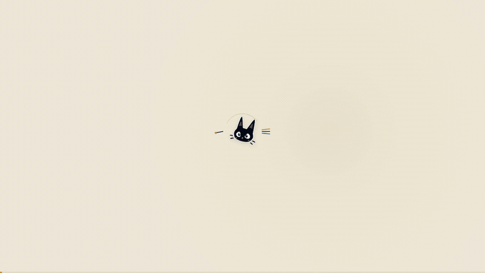
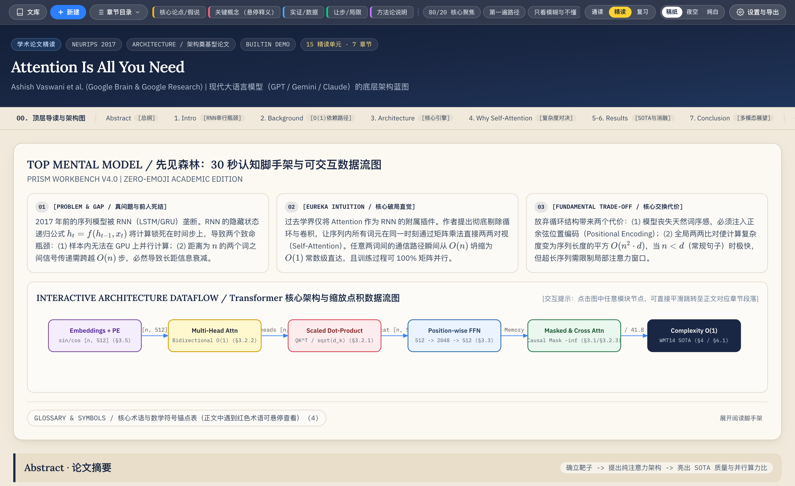
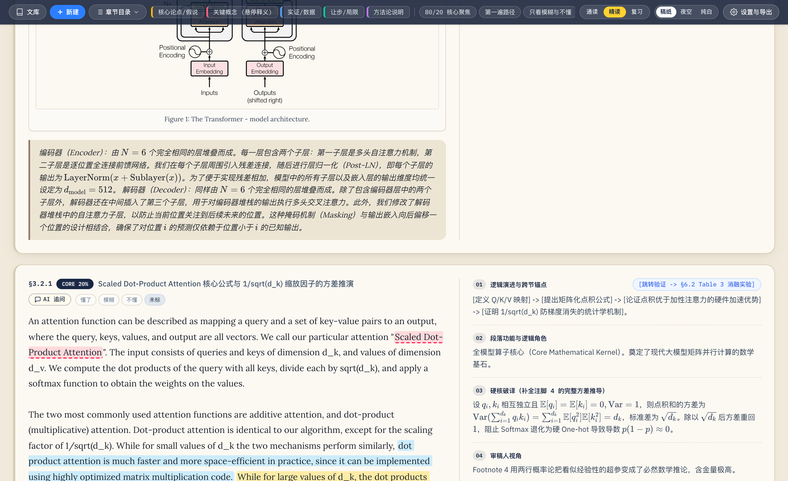
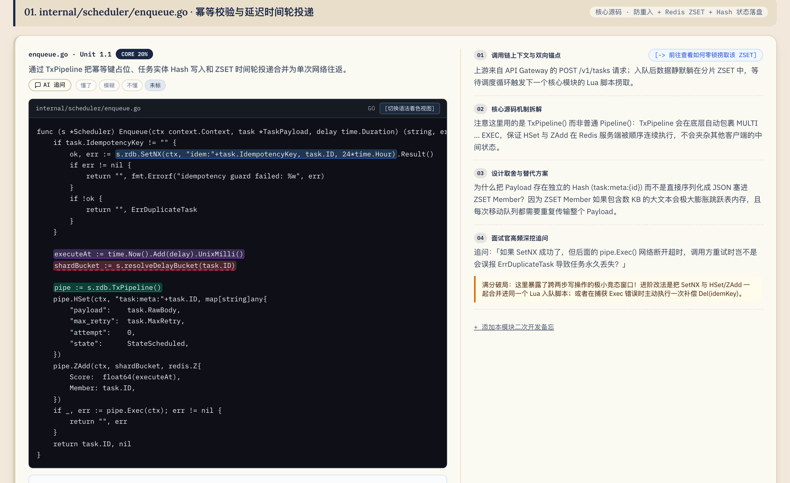
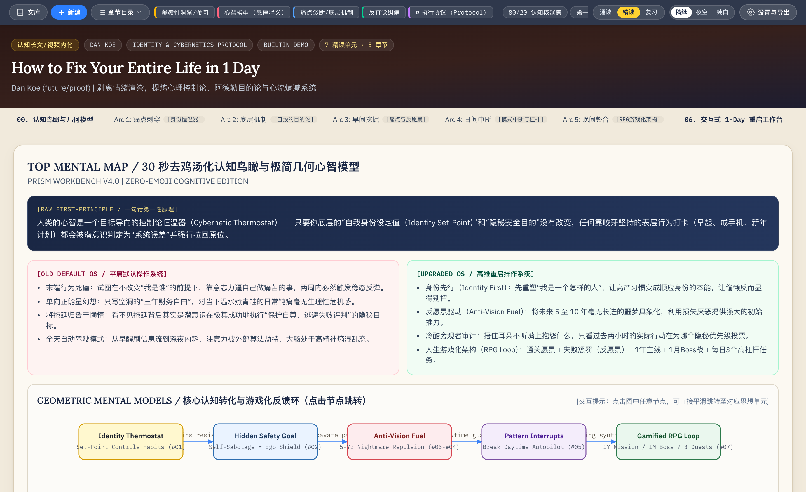

<div align="center">
  
  <h1>PurrParse</h1>
  <p>
    <strong>多模态主动精读与架构拆解工作台</strong><br />
    把 arXiv 论文、音视频长文与 GitHub 仓库，一键编排为结构化双栏知识晶体。
  </p>

  <p>
    <a href="https://github.com/lyz-wave/PurrParse/releases/latest">
      
    </a>
    
    
  </p>

  <p>
    <a href="https://purrparse.xyz"><strong>官网与在线演示</strong></a>
    &nbsp;&middot;&nbsp;
    <a href="#桌面端下载v113"><strong>下载桌面客户端</strong></a>
    &nbsp;&middot;&nbsp;
    <a href="#界面预览"><strong>界面截图</strong></a>
    &nbsp;&middot;&nbsp;
    <a href="#本地开发"><strong>本地开发</strong></a>
  </p>
</div>

<br />

<div align="center">
  <a href="https://purrparse.xyz" title="点击访问 PurrParse 官网观看 1080p 有声演示视频">
    
  </a>
  <br />
  <sub>
    ▶ <a href="https://purrparse.xyz"><strong>前往官网观看 1080p 完整有声演示视频（purrparse.xyz）</strong></a>
    &nbsp;&middot;&nbsp;
    <a href="./landing/media/prism-showcase.mp4">仓库原画视频文件（45s MP4）</a>
  </sub>
</div>

---

## 为什么是 PurrParse

不同于“直接给一段扁平摘要”的 AI 阅读工具，PurrParse 用同一套可扩展阅读骨架处理三种高摩擦知识载体，围绕**防幻觉溯源**与**主动回忆**构建工作流：

| 核心能力 | 说明 |
| :--- | :--- |
| **三大深读模态插件** | **学术论文**（arXiv / 本地 PDF → 先见森林导读、交互数据流、KaTeX 公式与张量维度流）<br />**长文 / 视频**（B 站 / 抖音链接或本地音频转写 → 去鸡汤第一性原理、控制论心智模型与行动清单）<br />**源码架构**（GitHub 仓库 / 代码文件 → `20/80` 核心调用链、并发竞态审计与面试防御追问） |
| **反幻觉精读与追问** | 同行双栏逐段对齐、五维语义高亮过滤、`20/80` 降噪、通读中英文互切；支持划词向 AI 追问并强制显式区分 `[原文明示 / 分析推断 / 原文未说明]`。 |
| **高并发后台解析坞** | 支持多篇链接 / 文件批量入队与并行分块调度（标准 `4` 并发 / 极速 `5` 并发），阅读或切换其他文章时后台解析不中断。 |
| **桌面原生 & 便携导出** | macOS / Windows 桌面客户端开箱即用，支持 **App 内检查更新与一键升级**；笔记与结构化图谱可零依赖导出为 **Markdown**、**Anki CSV** 与独立交互 **HTML**。 |

---

## 界面预览

<table>
  <tr>
    <td width="50%" align="center">
      
      <br />
      <sub><strong>工作台首页</strong>：全源直链输入框、并发极速模式、四维文库文件夹</sub>
    </td>
    <td width="50%" align="center">
      
      <br />
      <sub><strong>学术论文 · 先见森林</strong>：三栏破局直觉 + 可点击架构数据流图</sub>
    </td>
  </tr>
  <tr>
    <td width="50%" align="center">
      
      <br />
      <sub><strong>双栏精读网格</strong>：五维高亮聚焦、KaTeX 公式推导与跨节锚点跳转</sub>
    </td>
    <td width="50%" align="center">
      
      <br />
      <sub><strong>源码架构拆解</strong>：高亮代码切片、设计取舍与面试高频追问防御</sub>
    </td>
  </tr>
</table>

<details>
<summary>展开查看更多模式截图（认知与视频拆解 · 新建编排面板）</summary>
<br />
<table>
  <tr>
    <td width="50%" align="center">
      
      <br />
      <sub><strong>长文 / 视频模式</strong>：第一性原理提炼与几何心智反馈链</sub>
    </td>
    <td width="50%" align="center">
      
      <br />
      <sub><strong>多源编排面板</strong>：支持 arXiv 检索、本地 PDF、音视频链接与代码目录</sub>
    </td>
  </tr>
</table>
</details>

---

## 桌面端下载（v1.1.9）

> 也可以直接访问 [**purrparse.xyz**](https://purrparse.xyz) 自动识别本机系统与芯片架构下载。

| 平台 | 架构 | 安装包直链 |
| :--- | :--- | :--- |
| **macOS** | Apple Silicon (`M1–M4 / arm64`) | [`PurrParse-1.1.9-mac-arm64.dmg`](https://github.com/lyz-wave/PurrParse/releases/latest/download/PurrParse-1.1.9-mac-arm64.dmg) |
| **macOS** | Intel (`x64`) | [`PurrParse-1.1.9-mac-x64.dmg`](https://github.com/lyz-wave/PurrParse/releases/latest/download/PurrParse-1.1.9-mac-x64.dmg) |
| **Windows** | `x64`（64 位标准） | [`PurrParse-1.1.9-win-x64-Setup.exe`](https://github.com/lyz-wave/PurrParse/releases/latest/download/PurrParse-1.1.9-win-x64-Setup.exe) |
| **Windows** | `ARM64` | [`PurrParse-1.1.9-win-arm64-Setup.exe`](https://github.com/lyz-wave/PurrParse/releases/latest/download/PurrParse-1.1.9-win-arm64-Setup.exe) |

- **首次运行提示**：
  - **macOS**：项目使用开源 Ad-hoc 签名，若从浏览器下载后首次拖入「应用程序」提示“已损坏，无法打开”，在终端执行 `xattr -cr /Applications/PurrParse.app` 即可（后续通过 App 内在线更新会自动清除隔离属性并替换重启）。
  - **Windows**：若触发 SmartScreen 提示，点击「更多信息」→「仍要运行」即可。
- **App 内在线升级**：在应用右上角 **设置与导出 → 4. 应用版本与在线更新**（或顶部系统菜单 **检查更新…**）可检测新版本、下载安装包并一键应用更新。

---

## 本地开发

环境要求：`Node.js >= 22`、`pnpm >= 10`。

```bash
git clone https://github.com/lyz-wave/PurrParse.git
cd PurrParse
pnpm install
npm run dev
```

常用开发与构建命令：

```bash
npm run desktop:preview   # 构建 Next.js Standalone 并以 Electron 桌面窗体预览
npm run typecheck         # TypeScript 静态类型检查
npm test                  # Vitest 单元测试与 UI 集成测试
```

---

## 仓库结构

```text
.
├── src/
│   ├── app/              # Next.js 15 App Router 页面与服务端 API（解析 / 追问 / 更新）
│   ├── core/             # 领域契约（Zod AST）、LLM 并发分片编排、音视频转写与更新引擎
│   ├── plugins/          # 三大可插拔分析模式（academic-paper / cognitive-essay / repo-deconstruct）
│   ├── exporters/        # Markdown / Anki CSV / 零依赖单文件 HTML 编译器
│   ├── store/            # 客户端持久化工作台状态机与后台任务队列
│   └── workbench-ui/     # 精读交互界面、Liquid Glass 组件、任务坞与更新中心
├── electron/             # Electron 桌面外壳、预加载安全桥接与原生自动更新器
├── scripts/              # Standalone 依赖树扁平化打包与实机冒烟校验脚本
├── landing/              # purrparse.xyz 零构建静态官网与演示素材
├── prism-showreel/       # 1080p 宣传动画视频工程源码
└── docs/                 # 架构设计、产品规范、V4 提示词与独立 HTML 示例产物
    ├── architecture.md
    ├── product.md
    ├── prompts-v4.md
    ├── examples/
    └── media/
```

深入阅读：[系统架构与四大接缝设计](./docs/architecture.md) · [产品定位与防幻觉约束](./docs/product.md)
